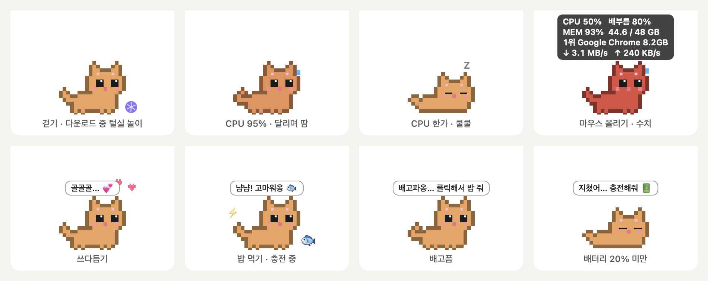

<div align="center">

# 🐾 SysPet

**맥 화면 아래를 걸어 다니는 픽셀 고양이 — 컴퓨터가 바쁘면 달리고, 한가하면 잡니다.**




</div>

---

## 이 고양이는요

CPU · 메모리 · 네트워크 · 배터리를 1초마다 살펴보고, 그 결과를 **기분과 몸짓**으로 보여 줍니다.
숫자 창을 띄워 둘 필요 없이, 고양이가 땀을 흘리고 있으면 "아, 지금 맥이 힘들구나" 하고 알 수 있어요.

| 컴퓨터 상태 | 고양이 |
|---|---|
| CPU 8% 미만 | 💤 엎드려서 쿨쿨 |
| CPU 보통 → 높음 | 🚶 걷기 → 🏃 달리기 (부하만큼 빨라짐) |
| CPU 또는 메모리 85% 이상 | 💦 땀 |
| 메모리 50% → 100% | 🧡 주황 털이 점점 ❤️ 빨갛게 |
| 다운로드 500KB/s 이상 | 🧶 털실 공 굴리며 놀기 |
| 배터리 20% 미만 (전원 없음) | 🔋 지쳐서 엎드림 |
| 충전 중 | ⚡ 번개 + 신나서 폴짝 |
| 메모리 80% 이상 | 🗣️ "Google Chrome 8.2GB 먹는 중!" |
| 밤 12시 ~ 5시 | 🌙 하품하며 "자러 가자" |

## 같이 놀기

| 하는 일 | 반응 |
|---|---|
| **마우스 올리기** | 멈춰서 수치 말풍선 — CPU · 배부름 · 메모리(사용/전체 GB) · 메모리 1위 앱 · ↓↑ 속도 |
| **몸 위에서 좌우로 문지르기** | 💕 하트 뿅뿅, "골골골…" |
| **클릭** | 폴짝 — 배고플 땐 🐟 밥 먹기 |
| **바닥 근처에서 커서 움직이기** | 커서를 쫓아 달려옴 |
| **가만히 두기** | 가끔 지금 보고 있는 창 위로 올라가 산책 |
| **오른쪽 클릭** | 메뉴 — 밥 주기 · 수치 항상 보기 · 커서 쫓아가기 · 창 위 올라타기 · 종료 |

> 배고픔은 3시간에 걸쳐 차오르고, 앱을 껐다 켜도 이어집니다. 밥 잘 챙겨 주세요.

## 설치 · 실행

Xcode 전체는 필요 없고 **Command Line Tools**만 있으면 됩니다 (`xcode-select --install`).

```bash
git clone https://github.com/JeongWonjae/syspet-cpu-memory-pet.git
cd syspet-cpu-memory-pet
./build.sh
open build/SysPet.app
```

Dock 아이콘 없이 조용히 떠 있어요. 끌 때는 고양이를 **오른쪽 클릭 → SysPet 종료**.

<details>
<summary>개발용 옵션</summary>

```bash
# 상태 모음 그림 다시 그리기 (위 README 이미지)
build/SysPet.app/Contents/MacOS/SysPet --snapshot docs/states.png

# 지금 읽히는 실제 수치 한 번 출력
build/SysPet.app/Contents/MacOS/SysPet --stats
```
</details>

## 어떻게 만들었나

- **Swift 파일 하나** (`Sources/main.swift`) + AppKit. 외부 라이브러리 없음.
- 투명한 `NSPanel`을 화면 맨 아래(Dock 바로 위)에 띄우고 0.1초마다 위치를 옮깁니다. 고양이 몸이 아닌 투명한 곳 클릭은 아래 창으로 그대로 통과해요.
- 고양이는 16×13 칸 문자열 스프라이트를 칸마다 사각형으로 칠해서 그립니다.

| 수치 | 읽는 곳 |
|---|---|
| CPU | `host_processor_info` — 전체 코어 tick 차이 |
| 메모리 | `host_statistics64` — 활성 + 고정 + 압축 페이지 (활성 상태 보기의 "사용된 메모리"에 가깝게) |
| 메모리 1위 앱 | `proc_pid_rusage` — 도우미 프로세스는 바깥 `.app` 이름으로 합산 |
| 네트워크 | `getifaddrs` — Wi-Fi·유선(`en*`) 받은/보낸 바이트 |
| 배터리 | IOKit `IOPSCopyPowerSourcesInfo` |
| 창 위치 | `CGWindowListCopyWindowInfo` — 창 위치만 쓰고, 창 제목·내용은 읽지 않음 |

🔒 **모든 수치는 내 맥 안에서만 읽고, 어디로도 보내지 않습니다.** 네트워크 요청도, 화면 녹화 권한도 쓰지 않아요.

## 앞으로

- [ ] 로그인할 때 자동 실행
- [ ] 다른 캐릭터(강아지 등) · 크기 설정
- [ ] 여러 모니터 지원
- [ ] 메뉴 설정 기억하기

## License

[MIT](LICENSE)
